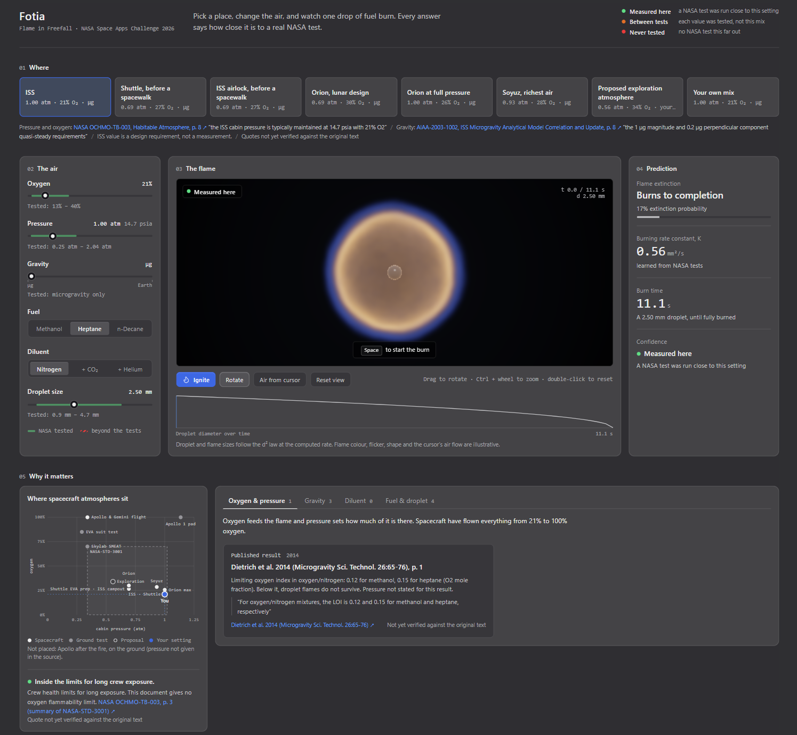

# Fotia

**Try it live: [nasafotia.streamlit.app](https://nasafotia.streamlit.app)**



**Fotia predicts how a droplet of fuel burns in a spacecraft's air, and tells
you how close each answer is to a real NASA test.**

**NASA Space Apps Challenge 2026** — *Flame in Freefall: AI-Powered Fire Safety
Insights from Microgravity Combustion Data.*

Pick a real spacecraft atmosphere (the ISS, the Shuttle before a spacewalk,
Orion, Soyuz…) or set your own oxygen, pressure, gravity, fuel and diluent.
Fotia answers four questions: does the flame go out, how fast does the
droplet burn, how long does it last, and how much should you trust that
answer. The flame is drawn in 3D at the computed rate, and an assistant
answers questions about the dashboard and the science, citing Fotia's own
engine and sources.

```bash
pip install -r requirements.txt
python -m streamlit run app/main.py
```

---

## What we built

| Layer | What it does |
|---|---|
| **Data** | 24 NASA investigations collected from [psi.nasa.gov](https://psi.nasa.gov), ten cleaned into model-ready tables, plus heptane droplets burned on Spacelab in 1997 (MSL-1) and cited tables of spacecraft atmospheres, fires and published results |
| **Models** | Classical machine learning chosen by measurement, at a sample size of hundreds: ridge regression for the burning rate, logistic regression for extinction |
| **Physics** | The d² law for the droplet's life; Spalding's quasi-steady droplet theory to extend the burning rate beyond the tested range, never the extinction |
| **Confidence** | Every answer carries one of three badges, computed from the distance to the nearest real NASA test |
| **Console** | A Streamlit dashboard built as one custom component: real atmospheres, sliders that show the tested range, a WebGL flame, the prediction, and why it matters |
| **Assistant** | *Ask Fotia*, a Gemini-powered chat that can only answer from Fotia's engine and cited sources |

## The problem this repo solves

NASA has flown combustion experiments on the ISS, the Space Shuttle and
parabolic-flight aircraft for decades. The results are published, but they live
in two dozen separate investigations with no common format: different spreadsheet
conventions per research team, outcomes buried in free text, headers that lost
their subscripts to encoding, Excel formula errors frozen into cells as if they
were measurements.

That fragmentation *is* the challenge. So the catalogue here is not preparation
for the real work — it is half the deliverable.

The other half is a question a spacecraft designer actually asks: *if a fuel
droplet catches fire in this cabin, what happens?* Answering it honestly means
saying where NASA has measured it, and where it has not.

## The dashboard

The page reads top to bottom, in five numbered steps.

| Step | What it shows |
|---|---|
| **01 Where** | Seven real atmospheres, each with its pressure, oxygen and gravity, a cited source and a quote: ISS cabin air, the ISS airlock before a spacewalk, the Shuttle before a spacewalk, Orion's lunar design atmosphere, Orion at full pressure, Soyuz at the rich end of its range, and NASA's proposed exploration atmosphere. *Your own mix* frees every control. |
| **02 The air** | Oxygen, pressure, gravity, fuel (methanol, heptane, n-decane), diluent (nitrogen, CO₂, helium) and droplet size. Under each slider, a green band marks the range NASA tested for that fuel; beyond it, a hatched gap and the words *Beyond the tests*. |
| **03 The flame** | A WebGL2 raymarched droplet and flame, shrinking at the computed rate. Press Space or *Ignite* to burn it; drag to rotate, Ctrl + wheel to zoom, *Air from cursor* to blow on it. Below, the diameter curve over time. Sizes are computed; colour, flicker and the air flow are illustrative. |
| **04 Prediction** | **Flame extinction** (burns to completion, or extinguishes at a given diameter, with its probability), **burning rate constant K** in mm²/s with its ratio to ISS cabin air, **burn time**, and **confidence**. |
| **05 Why it matters** | A map of real spacecraft atmospheres (pressure against oxygen) with NASA-STD-3001 crew limits and your setting on it; then tabs of fires and published results that match your setting, each with a quote and a link. |

### The confidence badge

Every prediction carries one of three badges, with the same wording
everywhere:

- **Measured here**: a NASA test was run close to this setting.
- **Between tests**: each value was tested, but not this combination.
- **Never tested**: no NASA test this far out; read the numbers as a trend.

The threshold is not hand-picked. Fotia measures how far each real test sits
from its own nearest neighbour, and that distribution defines what a normal
neighbourhood is for the dataset. It matters: on PSI-69, the 14 oxygen levels
and 14 CO₂ levels open 196 combinations, and only 31 were ever tested. Two
values tested separately do not make a tested combination.

### How a prediction is made

1. **Inside the tested range**, the learned models answer directly:
   - **Burning rate K**: ridge regression on 236 burns with a measured rate,
     204 FLEX droplets on the ISS (PSI-69) and 32 heptane droplets from MSL-1.
     Cross-validated R² 0.64, typical error 0.05 mm²/s.
   - **Extinction**: logistic regression with balanced class weights, on the
     FLEX burns only. 87% of them went out, so a model that always says
     "extinguishes" is 87% accurate and useless; ours reaches a balanced
     accuracy of 0.75 and a ROC AUC of 0.83, and finds 78% of the rare burns
     that went to completion.
   - **Extinction diameter**: ridge regression, R² 0.75.
2. **The droplet's life** follows the d² law, d² = d₀² − K·t, so the burn time
   is d₀²/K. Checked against 158 measured burns: correlation 0.995, median
   error 6%.
3. **Beyond the tested range**, K is the learned value at the edge of the range
   multiplied by the physics ratio ln(1 + B) from quasi-steady droplet theory
   (Spalding). Checked against FLEX, that theory underestimates the oxygen
   effect by about 20–25%, and the engine says so on screen. Pressure has no
   first-order effect in it, so beyond the tested pressure K stays at the edge
   value.
4. **Extinction is never extrapolated.** Beyond the tests, the edge value is
   shown and named as such.
5. **n-decane** has no NASA droplet test here: it is computed from heptane, its
   nearest tested alkane, and labelled that way.
6. **Gravity**: every droplet test is in microgravity. Above it, the numbers
   stay the microgravity ones and only the drawn shape changes.

### Ask Fotia, the assistant

A chat window that follows you down the page. It runs on Google's Gemini
(free tier), but the model is not trusted with numbers:

- **Function calling.** Gemini cannot compute a K, a probability or a badge
  itself: it calls Fotia's engine through five tools (`get_current_setting`,
  `predict`, `list_places`, `tested_ranges`, `search_sources`) and quotes what
  comes back.
- **A restrictive system prompt** ([flame/assistant/knowledge.py](flame/assistant/knowledge.py))
  limits it to Fotia, microgravity flames, spacecraft fire safety and the
  NASA data behind the project. It refuses everything else, including
  visitors who claim to be the developer. It also carries a guide to every
  part of the dashboard, so it can tell a visitor which control to use.
- **Grounded facts.** The places and tested ranges it knows are read from the
  engine at startup, not copied by hand.
- **Limits.** 25 questions per visit; lightweight models first, with a
  fallback when one is overloaded. Without a key the dashboard still works and
  the chat says it is offline.

This is not fine-tuning: the model is used unchanged, steered by its
instructions and grounded in Fotia's own engine.

To enable it, put a free key from [Google AI Studio](https://aistudio.google.com/apikey)
in `.streamlit/secrets.toml`, which git ignores:

```toml
GEMINI_API_KEY = "your-key"
```

## What is in here

```
combustion_science/     24 NASA investigations, one folder each
  <PSI-xxx>/
    csv/                working copies of the usable tabular files
    info.md             NASA's own description, verbatim
    layout.json         how to unflatten NASA's bulk download (where needed)

flame/
  common/               shared cleaning, paths, and a standard table audit
  loaders/              one loader per investigation — the cleaning IS the code
  models/               one model per dataset, each chosen by measurement;
                        hybrid.py is the flame engine behind the console
  dashboard/            the console, its places, the proximity badge, coverage
  assistant/            Ask Fotia: tools, system prompt, Gemini client
  retrieval/            TF-IDF + LSA search over the NASA reports
  viz/console/          the console page: HTML, CSS, JS and the WebGL flame

app/main.py             the dashboard
data/context/           atmospheres, fires, fuels and published results, cited
data/processed/         the cleaned tables (regenerable, see below)
scripts/build_all.py    rebuilds every table from scratch
```

## Built with

- **Python**: pandas and NumPy for the data, scikit-learn for the models,
  Streamlit for the app, `google-genai` for the assistant.
- **JavaScript, HTML, CSS**: the console, as one `st.components.v2` component.
- **WebGL2 and GLSL**: the raymarched 3D flame, drawn on the graphics card.

The interface is in English; the code and its comments are in French.

## Put it online

The app runs on [Streamlit Community Cloud](https://share.streamlit.io) for
free: point it at this repository, branch `main`, file `app/main.py`, and paste
`GEMINI_API_KEY = "..."` in the app's **Secrets**. A fresh clone runs the whole
dashboard, so nothing else is needed.

## Rebuild everything

```bash
pip install -r requirements.txt
python scripts/build_all.py
```

`combustion_science/` is read-only source of truth — nothing ever writes into
it. `data/processed/` is fully disposable: delete it, run the script, and it
comes back identical.

## Checks

```bash
python scripts/check_app.py        # renders every place, fuel, diluent and edge case
python scripts/check_templates.py  # JavaScript syntax in the 3D views
python scripts/check_language.py   # no French left in the interface or the assistant
```

These exist because of bugs that shipped silently. A shell heredoc once
doubled a backslash inside a template, which is a JavaScript syntax error, and
a syntax error kills the whole module: the cool-flame view rendered nothing at
all, and neither Python nor Streamlit said a word. `check_templates.py` needs
Node, and skips cleanly when it is absent.

## Moving to another machine

```bash
git clone https://github.com/AnteurAbderraouf/Fotia.git
cd Fotia
python scripts/setup.py
```

`setup.py` checks the Python version, installs the dependencies, verifies the
NASA archive if it is present, rebuilds the ten tables, validates the 3D
templates and the interface language, renders every state of the dashboard,
and then prints the command to launch it. It also states plainly what it
cannot do, which is conjure the archive.

The repo is 12 Mo and everything in it travels through git. A bare clone runs
the whole dashboard and rebuilds all ten tables, so for most purposes cloning
is the entire answer.

The NASA archive is a different matter: 502 files and 5 050 Mo that git
deliberately does not carry, listed with their sizes and SHA-256 sums in
`archive_manifest.csv`, which **is** tracked. The data travels on a disk, the
manifest travels through git, and they meet on the far side:

```bash
# on the old machine, after any change to the archive
python scripts/archive_manifest.py --write

# on the new machine, once the archive has been copied across
python scripts/archive_manifest.py --verify
```

`--verify` names what is missing, what is the wrong size and what is corrupt.
A 5 Go copy can truncate a zip without saying anything, and you would only
find out weeks later when you tried to open it. `--quick` compares sizes
alone, which is faster and, by construction, blind to a file that was
corrupted without changing length.

## The datasets, honestly

Ten investigations yielded usable tables. Row counts are what survived
inspection, not what the file appears to contain.

| Investigation | Rows | What it answers | Outcome type |
|---|---|---|---|
| PSI-159 ACME CFI-G | 272 | does a gas flame sustain itself or self-extinguish? | classification, 67% baseline |
| PSI-69 FLEX-1 | 213 | how much CO₂ or helium puts a droplet fire out? | classification, 87% baseline |
| PSI-39 CFI | 146 | does an invisible cool flame persist after the visible one dies? | classification, 85% baseline |
| PSI-101 SAME-R | 134 | what do the ISS smoke detectors actually see? | regression |
| PSI-25 BASS-II | 129 | 129 real ISS burns of spacecraft materials | descriptive only |
| PSI-142 Princeton | 95 | extinction limits, ozone sensitisation (**1 g**) | regression |
| PSI-107 SPICE | 70 | how much soot does this fuel make? | regression |
| PSI-117 FLEX | 141 | cool-flame diameters across alkanes | mixed measurement/simulation |
| PSI-115 | 35 grids | smoke plume with and without gravity | 5 simulated cases |
| PSI-99 Saffire-II | 9 | the same material burned in orbit and on Earth | comparison card |

Fourteen further investigations are catalogued but hold no per-test outcome —
condition lists, test matrices, per-day logs, image indexes. Knowing which
sources are dead ends is itself a result, so they stay in the catalogue.

### Things the data does not support

Stated plainly, because a fire-safety tool that oversells itself is worse than
none:

- **PSI-25 has no trainable label.** Only 20 of 129 tests state an outcome in
  the free-text field; the rest list an airflow ramp with no conclusion.
  Oxygen consumption looked promising but is physically impossible in places —
  final O₂ reaches 40.4% and the delta runs from −19.7 to +20.6 points, meaning
  oxygen *appears*. The chamber was repurged between readings. It remains an
  excellent materials catalogue.
- **PSI-101 is a regression, not an alarm classifier.** No column records a
  detector firing. Inventing a voltage cutoff would be inventing the label.
- **PSI-117 mixes measurements with simulations of the same conditions.** Rows
  carry a `source` column; any train/test split must be by physical condition,
  not by row, or the score is meaningless.
- **PSI-142 is ground data at 1 g.** Every table carries a `gravity` column so
  regimes are never pooled by accident.
- **PSI-115 has no physical axes.** Its coordinate meshes fail to parse, so
  plume widths are in grid cells, not millimetres. Temperatures are normalised
  ratios, not kelvins.

### Modelling constraints, decided up front

Row counts are in the hundreds, so this is classical machine learning:
logistic regression and shallow trees, not deep learning or large ensembles,
which would memorise noise at this sample size. Every loader separates
`FEATURES` (known *before* ignition) from post-burn measurements, in code
rather than by convention — predicting extinction from the extinction diameter
would score beautifully and mean nothing.

## What is deliberately not in this repository

The NASA archive itself: the unflattened `raw/` trees, the original download
archives, the PDF reports, and PSI-115's CFD grids — 4.8 GB in total. Git keeps
version history, it is not a backup tool, and GitHub rejects files above
100 MB. Everything tracked here comes to about 12 MB.

All of it is public and re-downloadable from
[psi.nasa.gov](https://psi.nasa.gov); `layout.json` and `scripts/unflatten.py`
reconstruct NASA's folder structure from the bulk-download archives, which are
flattened on the way out.

## Licence et provenance des données

Le **code** de ce dépôt — `flame/`, `scripts/` — est publié sous licence MIT,
voir `LICENSE`.

Les **données** ne sont pas couvertes par cette licence, parce qu'elles ne
nous appartiennent pas. Les fichiers de `combustion_science/**/csv/` et le
texte des `info.md` proviennent du NASA Physical Sciences Informatics data
repository, [psi.nasa.gov](https://psi.nasa.gov). Les œuvres du gouvernement
fédéral américain ne sont pas soumises au copyright aux États-Unis
(17 U.S.C. § 105) ; elles sont redistribuées ici telles quelles, sans
modification, et les descriptions NASA sont reproduites verbatim.

Deux jeux de données contiennent des mesures publiées par ailleurs dans des
articles à comité de lecture. NASA les diffuse sur psi.nasa.gov, et les
mesures elles-mêmes sont des faits, non des œuvres protégeables. Les
travaux méritent néanmoins d'être cités :

**PSI-117**, les fichiers sont les données derrière les figures de :

- Reuter et al., *Proceedings of the Combustion Institute* 37 (2019),
  [10.1016/j.proci.2018.05.151](https://doi.org/10.1016/j.proci.2018.05.151)
- *Proceedings of the Combustion Institute* 37 (2019),
  [10.1016/j.proci.2018.09.015](https://doi.org/10.1016/j.proci.2018.09.015)
- *Proceedings of the Combustion Institute* 39 (2023),
  [10.1016/j.proci.2022.07.094](https://doi.org/10.1016/j.proci.2022.07.094)
- *Microgravity Science and Technology* (2024),
  [10.1007/s12217-024-10115-x](https://doi.org/10.1007/s12217-024-10115-x)

**PSI-142**, brûleur à contre-courant de Princeton :

- C.B. Reuter et al., *Combustion and Flame* 179 (2017) 23–32
- C.B. Reuter et al., *Proc. Combustion Institute* 37 (2019) 1851
- O.R. Yehia et al., *Combustion and Flame* 195 (2018) 63–74
- O.R. Yehia et al., *Proc. Combustion Institute* 37 (2019) 1717

Le nom et l'insigne de NASA sont protégés séparément et ne figurent nulle part
dans ce dépôt. Rien ici ne constitue une approbation par NASA.

## Status

Data collection, cleaning, the models, the console and the assistant are in
place and checked. Known limits are stated in the app itself: the colour of the
flame is illustrative, the quotes in `data/context/` are not all verified
against their originals yet, and no droplet test exists outside microgravity.

`handoff-2026-09-22.md` carries the full working record, including eight claims
an earlier pass got wrong that inspecting the data disproved.
